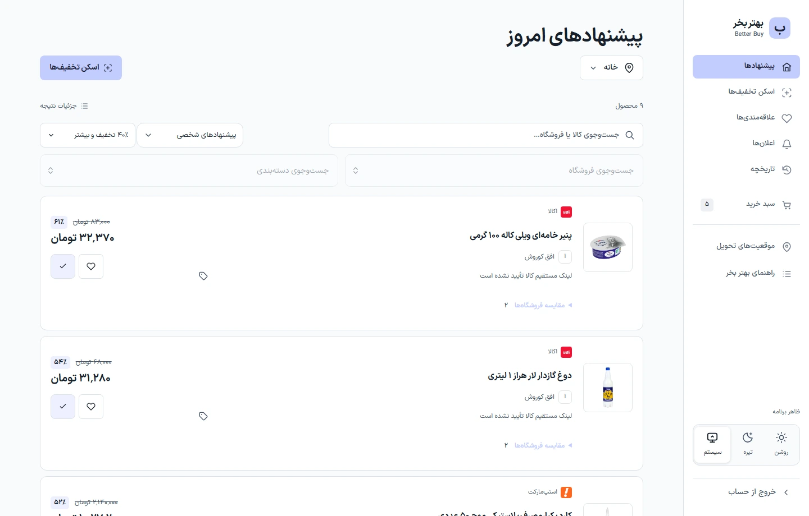
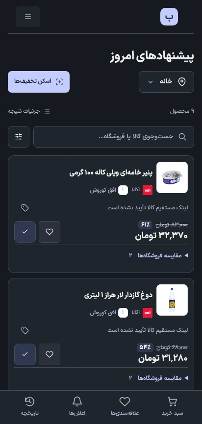
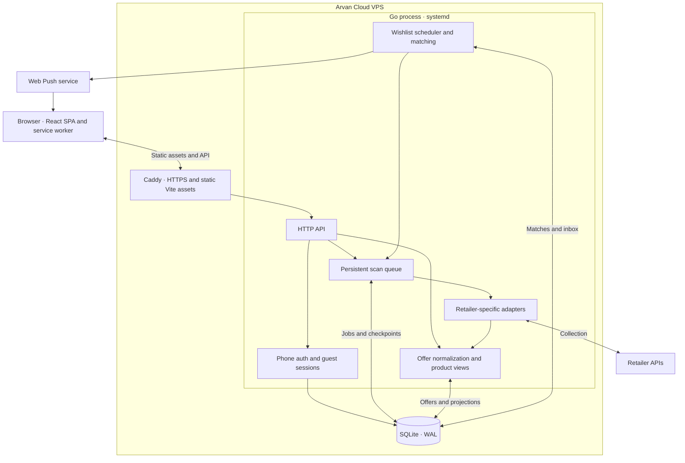

> [!IMPORTANT]
> **Better Buy is discontinued.** It was built to help Iranian shoppers discover grocery discounts and make better purchasing decisions. Comparing offers across retailers depended on consistent access to their product and promotion data. Snapp Market access from production infrastructure became intermittent, and a technical audit could not establish a sustainable way to collect that data automatically. We chose to discontinue development rather than offer a comparison product whose coverage we could not stand behind.

#  Better Buy

**Location-aware grocery deals and smarter shopping baskets for Tehran.**



<sub>Actual application rendered locally with a synthetic account, sample location, and fixture prices. Product photos are public catalogue assets.</sub>


[Product](#product) · [Engineering](#engineering-highlights) · [Architecture](#architecture) · [Performance](#performance-and-technical-evolution) · [Lessons](#technical-challenges-and-lessons) · [Run locally](#local-development)

## Product

A grocery promotion is useful only if the store delivers to the shopper, the item is available, and the price is current. Better Buy started with the delivery location, collected eligible offers, and displayed them in a searchable Persian workspace. Shoppers could adjust the discount threshold as they browsed saved results, inspect the stores behind each product, and plan a basket across stores within a retailer.

- **Find deals.** Pick a delivery point on an interactive map, scan supported retailers, and filter or sort results without starting another collection job.
- **Inspect an offer.** Open product details to compare store offers and distinguish current prices from historical or conditional offers.
- **Plan a basket.** Save quantities and see which stores can cover the basket, the estimated product total, and which items could not be matched.
- **Follow products.** Save search phrases and minimum discounts, choose a wishlist delivery location, and receive matching deals in an inbox with optional browser push.

|                                                             Mobile shopping · dark theme                                                              |                                                   Live scan · provisional results                                                   |
| :---------------------------------------------------------------------------------------------------------------------------------------------------: | :---------------------------------------------------------------------------------------------------------------------------------: |
|  |  |

[More application screenshots](docs/screenshots/README.md) show product details, the basket, a wishlist, and the location map. All screenshots show the real interface with demo data.

## Engineering highlights

| Area                           | Implementation                                                                                                                                                                                                                                                                                                                   |
| ------------------------------ | -------------------------------------------------------------------------------------------------------------------------------------------------------------------------------------------------------------------------------------------------------------------------------------------------------------------------------- |
| **Durable scans**              | The Go API accepts idempotent scan starts and persists job state, ownership claims, request attempts, and page checkpoints in SQLite. After a process restart, the queue can reclaim interrupted work and reuse saved provider responses. Live offers are provisional; final results and coverage are committed transactionally. |
| **Retailer adapters**          | Snapp Market, Okala, and Digikala Fresh have distinct discovery, authentication, pagination, and validation paths. Collection uses bounded concurrency where supported. Okala coordinates reusable store and category responses through SQLite to reduce overlapping requests.                                                   |
| **Product and offer identity** | Provider records are normalized before storage and projection. The read API groups comparable products while preserving vendor-specific prices and availability. Location revisions and scan scope make freshness and coverage explicit. Incomplete coverage affects baseline comparisons.                                       |
| **Basket recommendation**      | A bounded search assigns available items at the requested quantities, prioritizing fewer stores and then a lower product subtotal. Results report missing items and whether optimality was proved within the search budget.                                                                                                      |
| **Identity and isolation**     | Phone/password sign-in, SMS OTP verification and recovery, and persistent abuse limits. Expiring guest sessions have a separate identity; account and guest operations are scoped to the caller. Saved guest locations can be imported on sign-in.                                                                               |
| **Scheduled alerts and PWA**   | The Go scheduler runs wishlist scans for supported providers, matches new or cheaper offers, and records notifications. Optional VAPID Web Push reaches the browser through a service worker. The installable PWA includes a manifest and icons.                                                                                 |
| **Frontend and testing**       | React 19 with React Compiler, Vite, TanStack Router and Query, and MapLibre. The UI supports Persian RTL, desktop and mobile layouts, and light and dark themes. Go tests exercise collection and persistence, Vitest covers frontend behavior, and Playwright exercises browser flows with fixture API responses.               |

## Architecture

The deployment used Caddy and systemd on an Arvan Cloud VPS. Caddy served static Vite assets and proxied API requests to the loopback Go listener. The HTTP API, scan worker, and wishlist maintenance ran in one Go process with SQLite in WAL mode.



## Performance and technical evolution

The **Go backend rewrite** consolidated the HTTP API, durable collection, and maintenance into one service. SQLite remained the persistence layer. Embedded migrations and a separate backup command supported operation on a small VPS. The rewrite plan leaves idle memory and full parity measurement open. [Backend rewrite notes](docs/planning/go-vps-backend-rewrite.md) · [Deployment configuration](deploy/vps/README.md)

The **Next.js to Vite migration** moved the frontend to a static SPA with TanStack routing and route splitting. The migration report recorded these compressed sizes for the initial route:

| Recorded benchmark             |  Next.js |     Vite | Reduction |
| ------------------------------ | -------: | -------: | --------: |
| Initial JavaScript, gzip       | 305.5 kB | 232.4 kB |     23.9% |
| Initial JavaScript + CSS, gzip | 342.5 kB | 269.3 kB |     21.4% |

These are historical bundle measurements. The report used synthetic API responses for its local mobile run. Production loading performance, a comparable before-and-after LCP, and the remaining migration acceptance criteria were unverified. [Frontend migration report](docs/planning/M0-frontend-migration-report.md)

An **Okala collector benchmark** recorded 3,207 observed products and 669 qualifying offers from a sample store. Both cold configurations sent 81 upstream requests. The 12- and 24-request concurrency limits completed in 1.17 seconds and 0.98 seconds respectively, with no upstream requests on the warm store catalogue run. The 24-request run saturated the VPS's one CPU core. These are single-store measurements. [Okala benchmark](docs/okala-scan-performance.md)

## Technical challenges and lessons

- **Make incomplete data explicit.** Pagination drift, failed requests, and changing stock can make a feed look complete when it is missing offers. Separating provisional results from final snapshots and recording coverage made those gaps visible to shoppers and downstream features.
- **Make background work safe to resume.** A scan can outlive the browser or a server process. Stable request keys, persisted checkpoints, and ownership checks let the worker reuse completed calls and prevent a stale worker from publishing results.
- **Treat identity and delivery as part of the data model.** A product can have several vendor offers, and a vendor can be eligible at one address and unavailable at another. Preserving store identity and the location revision made comparisons and basket recommendations more meaningful.
- **Measure mobile and infrastructure trade-offs separately.** A smaller bundle reduces transfer cost, but loading time also depends on latency and the rendering path. More collector concurrency can improve a cold scan while leaving less headroom for other work. A static frontend and one backend process kept the deployment simple to operate.
- **Validate key dependencies before scaling.** The final audit traced production Snapp Market failures to the initial guest token request. Local access was enough to collect the base feed, but the bounded local full-scope attempt did not finish campaign discovery. The precise cause of the production rejection remained unverified. That evidence was enough to conclude that sustained automatic coverage for the original cross-retailer product could not be established. [Final feasibility audit](docs/snapp-market-acquisition-audit.md)

## Repository structure

```text
apps/
  api/                 Go API, auth, collectors, scan queue, carts, and alerts
    internal/storage/  SQLite connection and embedded migrations
  web/                 React SPA, PWA assets, and Playwright fixtures
packages/
  shared/              TypeScript contracts and display helpers
deploy/vps/            Caddy, systemd, and SQLite backup configuration
docs/                  Architecture notes, benchmarks, audit, and screenshots
scripts/               Repository development and maintenance utilities
```

## Local development

Install **Go 1.27+**, **Node.js 24** (the version used for verification), and **pnpm 10.12.1**. Run commands from the repository root.

### Fixture walkthrough without retailer access

The repository has browser fixtures rather than a standalone demo backend. These scenarios open the built application with intercepted API responses and no Go server or production credentials. Use the existing Chrome configuration on Windows, set `PLAYWRIGHT_CHROME_PATH` for a local Chromium-based executable, or install Playwright's Chromium.

```sh
pnpm install --frozen-lockfile
pnpm --filter @better-buy/web exec playwright install chromium
pnpm --filter @better-buy/web build
pnpm --filter @better-buy/web exec playwright test tests/combined-feed.spec.ts \
  --config playwright.export.config.ts --project desktop --headed \
  --grep "both providers merge|product details show|navigation opens"
```

Use `--debug` to step through a flow or `--project mobile` to see the Pixel 7 viewport. The tests cover saved results, filters, product details, and navigation. [Fixture source](apps/web/tests/combined-feed.spec.ts)

### Run the full stack

`pnpm dev` starts Go on `127.0.0.1:8787` and Vite on `127.0.0.1:3000`. The API reads the shell environment directly. The example below uses a fresh local database and mock SMS. It assumes a POSIX shell with OpenSSL available.

```sh
pnpm install --frozen-lockfile
mkdir -p .data
export VPS_DATABASE_PATH="$PWD/.data/better-buy-local.sqlite"
export VPS_HTTP_HOST=127.0.0.1 VPS_HTTP_PORT=8787
export BETTER_AUTH_URL=http://127.0.0.1:8787
export APP_ORIGIN=http://127.0.0.1:3000 CORS_ORIGIN=http://127.0.0.1:3000
export BETTER_AUTH_SECRET="$(openssl rand -hex 32)"
export OTP_SECRET="$(openssl rand -hex 32)"
export BOX_KEY="$(openssl rand -hex 32)"
export DEV_MODE=true SMS_PROVIDER=mock WISHLIST_SCHEDULE_ENABLED=false

pnpm api:migrate
pnpm dev
```

Open `http://127.0.0.1:3000`. Check `http://127.0.0.1:3000/healthz` for the API through Vite's proxy. Keep the same secrets if you reuse the database. Mock SMS stays local; push requires a separate VAPID configuration. Real scans depend on upstream availability and can fail even when the application is running correctly. See [environment variables](.env.example), [phone authentication](docs/phone-auth.md), and [PWA behavior](apps/web/PWA.md).

### Guest access

Guest browsing and scans use an expiring, cookie-backed identity. Only the session cookie hash is persisted, and read and scan-start limits still apply to guest sessions. Browser storage remembers delivery locations. On sign-in, confirmed locations can be imported with retry-safe matching; scan history remains attached to the temporary guest identity. Clearing cookies or storage can lose access. [Guest API](apps/api/internal/api/guest.go)

### Project references

[API guide](apps/api/README.md) · [Deployment runbook](deploy/vps/README.md) · [Portfolio gallery](docs/screenshots/README.md) · [Feasibility audit](docs/snapp-market-acquisition-audit.md)
