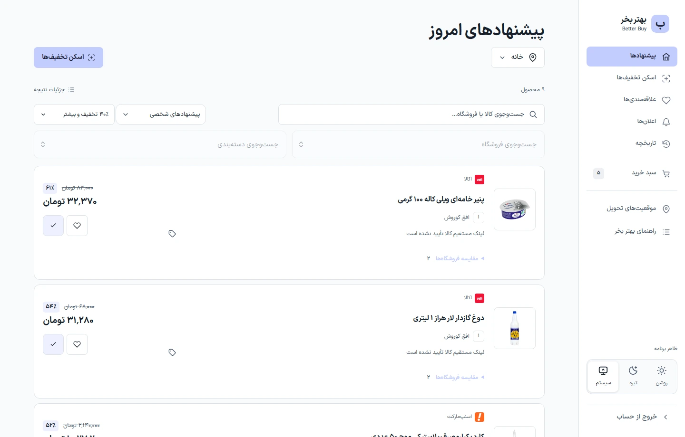
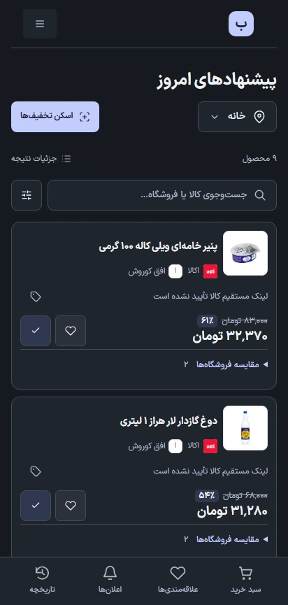
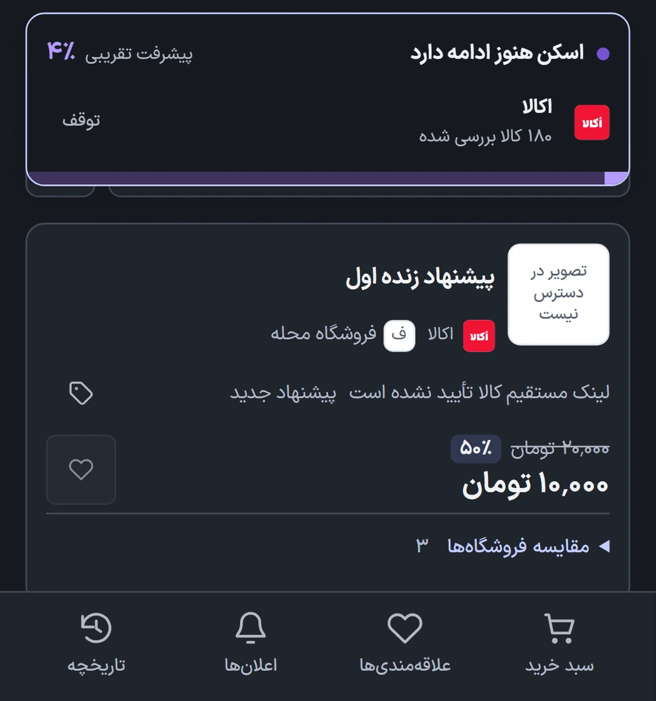
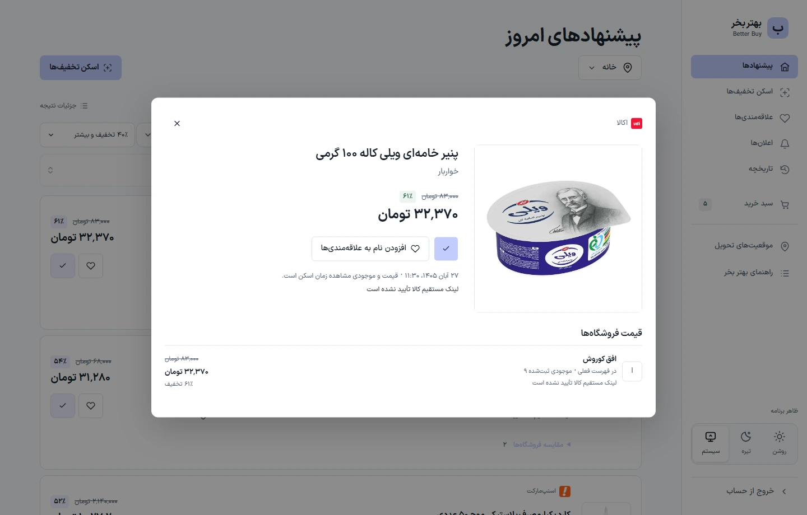
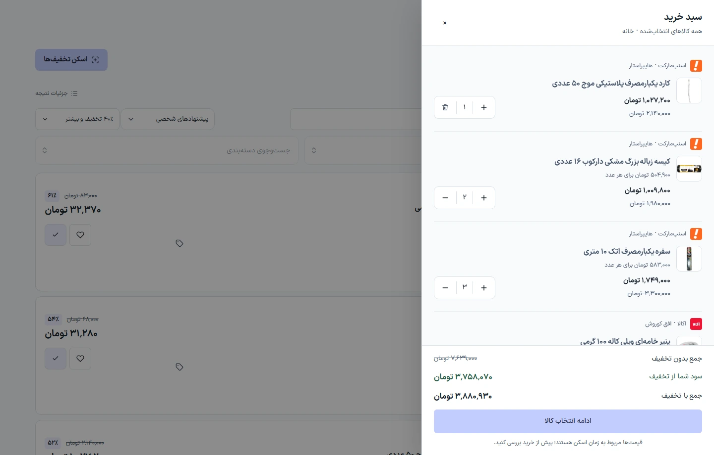
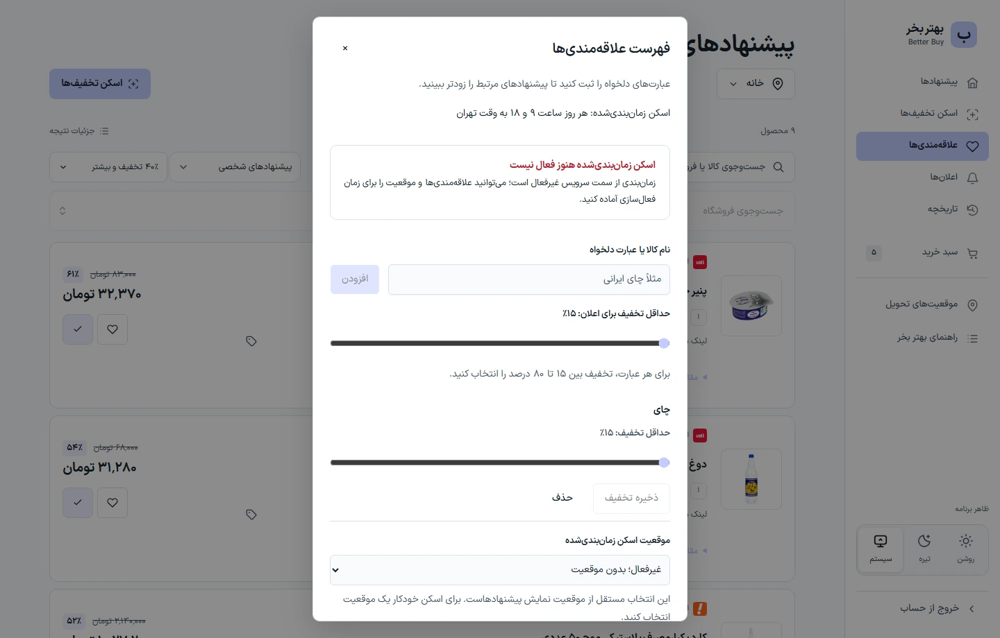
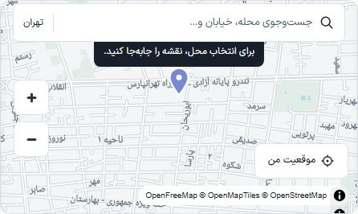

# Better Buy screenshot gallery

These captures show the actual Persian application in Chromium. The account, delivery location, offer prices, and scan progress are demo fixtures. Product photographs come from public catalogue assets. The captures contain no production account data.

## Browse deals

 

## Inspect a product and plan a basket

## Save interests and select a delivery location

The desktop, mobile, details, basket, and wishlist screens were captured against a local Vite production build using the [combined feed fixture](../../apps/web/tests/combined-feed.spec.ts) with additional synthetic catalogue and basket responses. The scan and map screens come from existing [dashboard](../../apps/web/tests/dashboard.spec.ts) and [guest](../../apps/web/tests/guest.spec.ts) fixtures. Images are compressed WebP captures.

[Back to Better Buy](../../README.md)
